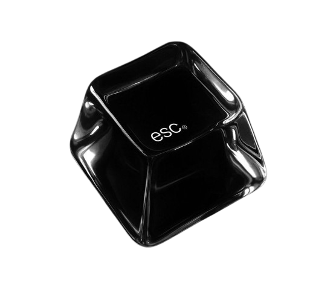

  

  

  
  
  

  
  

 

---

### Full Stack Developer

I'm a **Full Stack Developer** passionate about building modern, secure, and scalable web applications from the database to the user interface.

On the **front-end**, I build responsive and accessible interfaces with **React**, **Next.js**, **TypeScript**, and **Tailwind CSS**. On the **back-end**, I design and develop **REST APIs** with **C# and ASP.NET Core**, using **Entity Framework Core**, **SQL Server**, and **PostgreSQL**, with authentication and authorization based on **JWT** and **ASP.NET Identity**.

I care about clean, maintainable code, solid architecture (SOLID, DRY, KISS), performance, and security, and I'm constantly learning about **software architecture**, **cloud**, **UI/UX**, and **machine learning** through personal projects.

I'm looking for opportunities to collaborate with talented teams, contribute to meaningful products, and keep growing as a software developer while delivering high-quality digital experiences across the whole stack.

 

---

  <h3>Technologies</h3>

  
  
  
  
  
  
  
  
  
  
  
  
  
  
  
  
  
  
  
  

 

---

  <h3>Statistics</h3>

 

  
  

---

  

